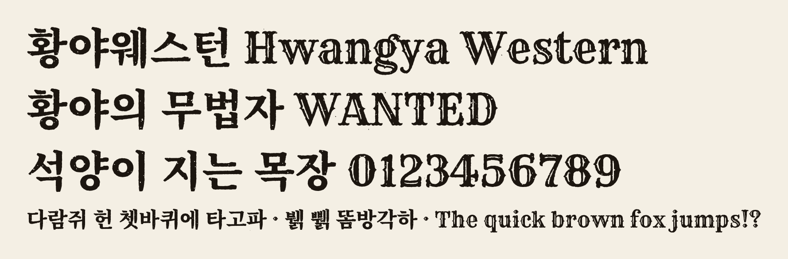

# 황야웨스턴 1.0 사용 안내

서부극 포스터의 나무 활자 느낌을 낸 제목용 서체입니다. 영문·숫자는 Rye, 한글은 본명조(Noto Serif CJK KR Black)를 바탕으로 거친 잉크 외곽선과 닳은 자국을 넣었습니다. 한글 11,172자를 모두 지원합니다.



## 설치

- 윈도우: `HwangyaWestern-Regular.ttf`를 마우스 오른쪽 버튼으로 누르고 '설치'를 고릅니다.
- 맥: 파일을 열고 '서체 설치'를 누릅니다.

글꼴 목록에는 '황야웨스턴'(영문 환경에서는 Hwangya Western)으로 나옵니다.

## 웹에서 쓰기

```css
@font-face { font-family: "Hwangya Western"; src: url("HwangyaWestern-Regular.woff2") format("woff2"); font-display: swap; }

h1 { font-family: "Hwangya Western", serif; }
```

거친 외곽선 때문에 점이 많아 웹폰트 파일이 7MB입니다. 웹에서는 전체 파일을 올리지 말고 `pyftsubset`으로 제목에 쓰는 글자만 추려서 쓰세요.

```bash
pyftsubset HwangyaWestern-Regular.ttf --text="황야의 무법자 WANTED" --flavor=woff2 --output-file=western-subset.woff2
```

## 수록 글자와 제한

- 한글 음절 11,172자, 한글 낱자모, 영문·숫자·기본 기호, 줄표(–, —)가 들어 있습니다.
- 악센트가 붙은 로마자(é 등)는 없습니다.
- 닳은 자국은 큰 글씨에서 보이도록 만든 것입니다. 제목용으로만 쓰세요.

## 라이선스

SIL Open Font License 1.1 (`OFL.txt`). 인쇄물·웹·영상·로고·제품에 상업적으로 쓸 수 있습니다. 폰트 파일만 단독으로 판매하는 것은 금지됩니다. 수정해서 배포할 때는 OFL을 유지하고, 이름에 "Rye"와 "Source"를 쓰지 않아야 합니다.

`소스/`에 생성 스크립트(`build.py western`)와 제작 노트가 들어 있습니다.
