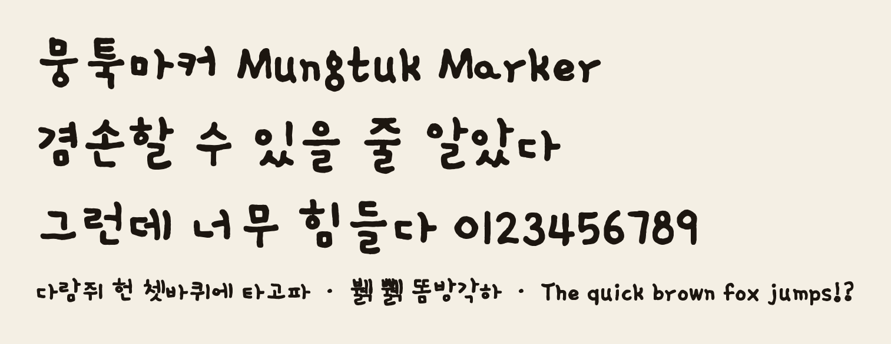

# 뭉툭마커 1.0 사용 안내

굵은 마커로 눌러 쓴 듯한 한글 손글씨 서체입니다. 감자꽃(Gamja Flower)을 바탕으로 획을 굵게 하고 끝을 둥글렸으며, 약한 손떨림을 넣었습니다. 한글 11,172자를 모두 지원합니다.



## 설치

- 윈도우: `MungtukMarker-Regular.ttf`를 마우스 오른쪽 버튼으로 누르고 '설치'를 고릅니다.
- 맥: 파일을 열고 '서체 설치'를 누릅니다.

글꼴 목록에는 '뭉툭마커'(영문 환경에서는 Mungtuk Marker)로 나옵니다.

## 웹에서 쓰기

```css
@font-face { font-family: "Mungtuk Marker"; src: url("MungtukMarker-Regular.woff2") format("woff2"); font-display: swap; }

.memo { font-family: "Mungtuk Marker", sans-serif; }
```

웹폰트 파일이 3.6MB입니다. 문구가 정해진 페이지라면 `pyftsubset`으로 쓰는 글자만 추려서 올리는 편이 좋습니다.

```bash
pyftsubset MungtukMarker-Regular.ttf --text="겸손할 수 있을 줄 알았다" --flavor=woff2 --output-file=marker-subset.woff2
```

## 수록 글자와 제한

- 한글 음절 11,172자, 한글 낱자모, 영문·숫자·기본 기호가 들어 있습니다.
- 줄표(–, —)와 악센트가 붙은 로마자(é 등)는 없습니다. 바탕이 된 감자꽃에 없는 글자입니다.
- '풹' 한 글자는 다른 글자보다 크게 나옵니다. 감자꽃 원본에서 온 문제입니다.
- 윤곽선을 이미지에서 추출했기 때문에 작은 크기에서는 획이 고르지 않게 보일 수 있습니다.

## 라이선스

SIL Open Font License 1.1 (`OFL.txt`). 인쇄물·웹·영상·로고·제품에 상업적으로 쓸 수 있습니다. 폰트 파일만 단독으로 판매하는 것은 금지됩니다. 수정해서 배포할 때는 OFL을 유지해야 합니다.

`소스/`에 생성 스크립트(`build.py marker`)와 제작 노트가 들어 있습니다.
