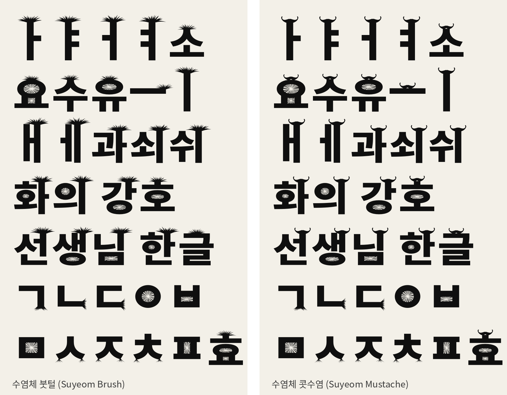

# 수염체 1.0 사용 안내

글자 위에 수염 장식이 달린 한글 제목용 서체입니다. 본고딕(Noto Sans CJK KR Black)을 바탕으로 만들었습니다. 제목·로고처럼 크게 쓰는 용도이며 본문용이 아닙니다.



## 글꼴 두 가지

| 글꼴 | 파일 | 모음 위 장식 |
|---|---|---|
| **수염체 붓털** (Suyeom Brush) | `SuyeomBrush-Regular` | 부채꼴로 퍼지는 붓털 |
| **수염체 콧수염** (Suyeom Mustache) | `SuyeomMustache-Regular` | 끝이 말려 올라간 콧수염 |

두 글꼴 모두 ㅇ·ㅁ·ㅂ·ㅍ·ㅎ의 막힌 공간을 방사형 수염으로 채웁니다. 영문·숫자·기호는 본고딕 그대로입니다.

## 설치

- 윈도우: `.otf` 파일을 마우스 오른쪽 버튼으로 누르고 '설치'를 고릅니다.
- 맥: `.otf` 파일을 열고 '서체 설치'를 누릅니다.

글꼴 목록에는 '수염체 붓털', '수염체 콧수염'으로 나옵니다.

## 웹에서 쓰기

```css
@font-face { font-family: "Suyeom Brush"; src: url("SuyeomBrush-Regular.woff2") format("woff2"); font-display: swap; }
@font-face { font-family: "Suyeom Mustache"; src: url("SuyeomMustache-Regular.woff2") format("woff2"); font-display: swap; }

h1 { font-family: "Suyeom Brush", sans-serif; line-height: 1.4; }
```

## 수록 글자와 제한

- 한글은 **KS X 1001 완성형 2,350자**만 들어 있습니다. '뷁', '똠'처럼 완성형에 없는 글자는 다른 글꼴로 바뀌어 보입니다.
- 그 밖에 한글 낱자모 51자, 영문·숫자·기본 기호가 들어 있습니다. 악센트가 붙은 로마자(é 등)는 없습니다.
- 장식이 글자 위로 올라가므로 줄 간격은 **1.4 이상**을 권장합니다.
- 장식이 가늘어서 작은 크기에서는 잘 보이지 않습니다. 제목 크기로 쓰세요.

## 라이선스

SIL Open Font License 1.1 (`OFL.txt`). 인쇄물·웹·영상·로고·제품에 상업적으로 쓸 수 있습니다. 폰트 파일만 단독으로 판매하는 것은 금지됩니다. 수정해서 배포할 때는 OFL을 유지하고, 이름에 "Source"를 쓰지 않아야 합니다.

`소스/`에 생성 스크립트(`build.py`)와 제작 노트가 들어 있습니다.
